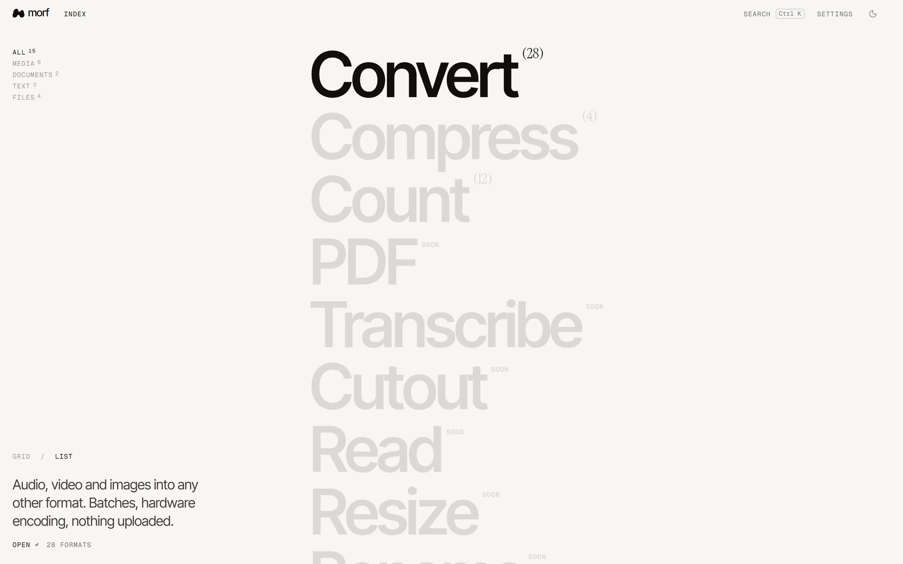
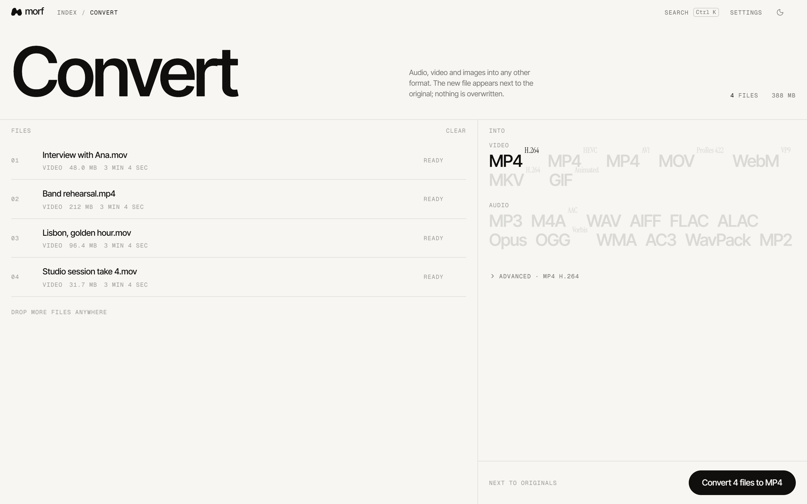
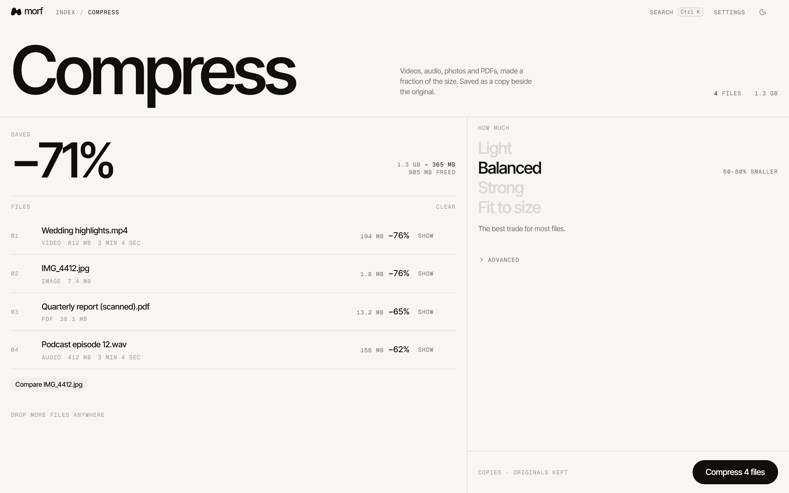
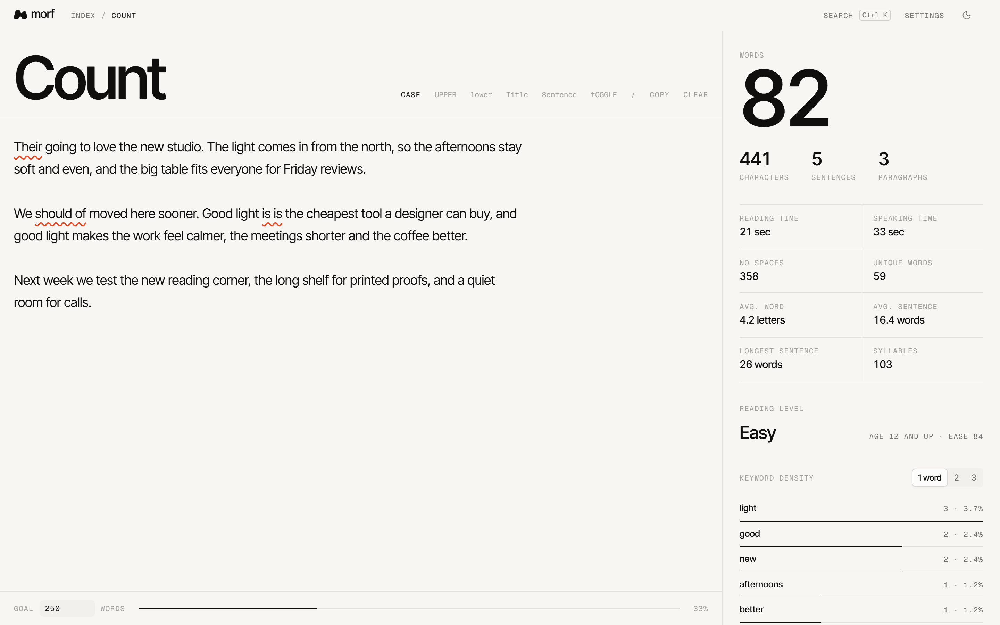
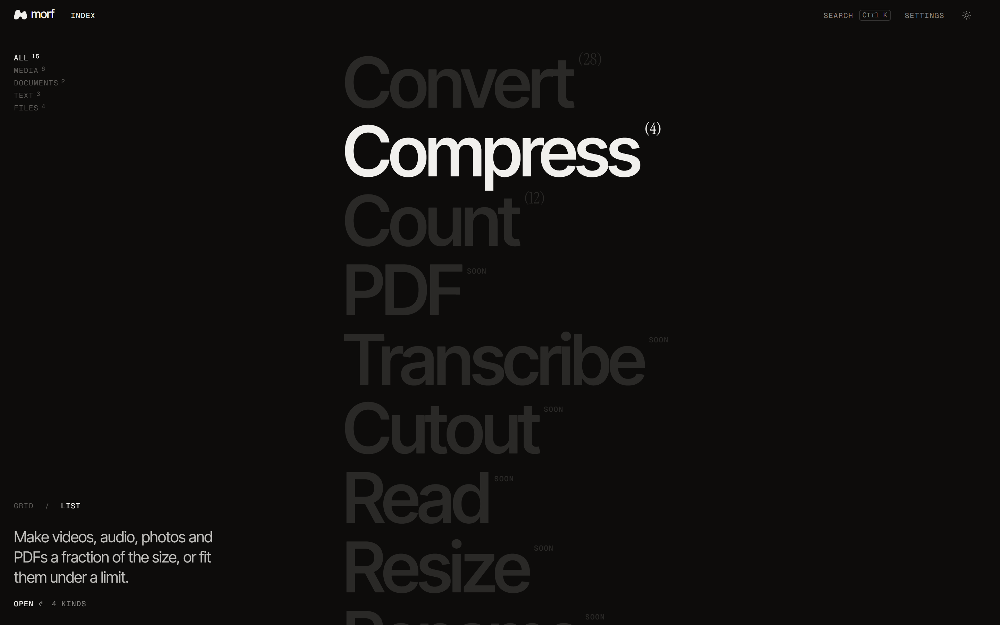

<p align="center">
  <picture>
    <source media="(prefers-color-scheme: dark)" srcset="docs/brand/mark-light.png">
    
  </picture>
</p>

<h1 align="center">morf</h1>

<p align="center">
  <strong>Convert, compress and count. All on your computer.</strong><br>
  One quiet place for the small jobs files need. No accounts, no uploads, no analytics.
</p>

<p align="center">
  <a href="https://github.com/giancoferrari/morf/releases/latest/download/Morf_0.1.0_x64-setup.exe"><strong>Download for Windows</strong></a>
  &nbsp;·&nbsp;
  <a href="https://github.com/giancoferrari/morf/releases">All releases</a>
  &nbsp;·&nbsp;
  <a href="#build-it-yourself">Build it yourself</a>
</p>

<p align="center">
  
  
  
  
</p>

<br>

<p align="center">
  
</p>

<br>

## What's inside

| | |
|---|---|
| **Convert** | Audio, video and images into **28 formats**: MP4 (H.264, HEVC, AV1), MOV ProRes, WebM, MKV, animated GIF, MP3, AAC, FLAC, ALAC, Opus, WAV, AIFF, OGG, JPEG, PNG, WebP, AVIF, TIFF, ICO, PDF and more. Uses your graphics card (NVENC, Quick Sync, AMF) when it can, and falls back to software when it can't. |
| **Compress** | Video, audio, photos and PDFs. Pick **Light**, **Balanced** or **Strong**, or **fit to a size**: 8 MB for Discord, 16 MB for WhatsApp, 25 MB for email, or any number. Compare before and after with a slider. |
| **Count** | A private word counter: words, characters, sentences, paragraphs, reading and speaking time, reading level, keyword density for one to three words, case changes and a word goal, plus a grammar check that runs offline. |

More tools are on the way: a PDF toolkit, transcription, background removal, text recognition, batch rename and resize, archives, metadata, compare, QR codes, colour palettes, and **recipes** that chain tools together on a watch folder.

<table>
  <tr>
    <td width="50%"></td>
    <td width="50%"></td>
  </tr>
  <tr>
    <td width="50%"></td>
    <td width="50%"></td>
  </tr>
</table>

## How much smaller

Measured on generated test files with the built-in smoke test (`npm run smoke`). Your files will
differ; already-compressed sources shrink less.

| | Light | Balanced | Strong |
|---|---:|---:|---:|
| Video (H.264 source → H.265) | −71% | −81% | −89% |
| Photo (JPEG) | −48% | −58% | −67% |
| Graphic (PNG) | −46% | −64% | −68% |
| Scanned PDF | −71% | −89% | −95% |

Images use progressive JPEG with optimised tables, libwebp, AVIF and palette PNG (libimagequant +
oxipng). Video uses x264, x265 or SVT-AV1, with two-pass encoding when a size limit is set. PDFs
have their embedded pictures resized and re-encoded; text and vector art are left alone.

## Promises

- **Nothing leaves your computer.** Morf has no network code for your files, no telemetry, no account.
- **Originals are never overwritten.** A new file is saved next to the original (`photo.jpg` → `photo 2.jpg` if the name is taken), or in a folder you choose.
- **Nothing half-finished is left behind.** Stop works at any moment and cleans up.
- **Read-only folders don't fail.** Results go to Downloads, and Morf tells you.
- **It reads the file, not just the name.** A song renamed to `.jpg` gets a clear sentence, not a decoder error.

## Install

1. Download **[Morf_0.1.0_x64-setup.exe](https://github.com/giancoferrari/morf/releases/latest/download/Morf_0.1.0_x64-setup.exe)** (56 MB, ffmpeg included).
2. Run it. It installs for your user only, so no administrator prompt.
3. Windows SmartScreen may say it doesn't recognise the app, because the installer isn't code-signed yet. Choose **More info → Run anyway**.

To add **Convert with Morf** and **Compress with Morf** to Explorer's right-click menu, open **Settings → Output** in Morf and switch it on. On Windows 11 the items are under **Show more options**.

A macOS version is planned.

## Keyboard

| | |
|---|---|
| <kbd>Ctrl</kbd> <kbd>K</kbd> | Search tools and actions |
| <kbd>Ctrl</kbd> <kbd>1</kbd> · <kbd>2</kbd> · <kbd>3</kbd> | Convert · Compress · Count |
| <kbd>↑</kbd> <kbd>↓</kbd> <kbd>Enter</kbd> | Move through the index and open a tool |
| <kbd>Ctrl</kbd> <kbd>,</kbd> | Settings |
| <kbd>Esc</kbd> | Back to the index |

## Build it yourself

You need Node 20 or later, Rust (stable) and, on Windows, the Visual Studio C++ Build Tools.

```powershell
git clone https://github.com/giancoferrari/morf.git
cd morf
npm install
npm run app        # downloads the bundled ffmpeg once, then opens Morf
```

| Command | What it does |
|---|---|
| `npm run dev` | Just the interface, in a browser, with a pretend engine |
| `npm run app` | The full desktop app in development mode |
| `npm run release` | The installer, in `src-tauri/target/release/bundle/nsis` |
| `npm run test:engine` | Rust unit tests |
| `npm run smoke` | Generates sample files and runs every format and compression level |

The engine also works from a terminal:

```powershell
morf.exe --cli formats
morf.exe --cli convert mp3 "song.wav"
morf.exe --cli compress balanced "clip.mov"
morf.exe --cli compress 8mb "clip.mov"
```

<details>
<summary><strong>How it's put together</strong></summary>

<br>

Morf is a [Tauri 2](https://tauri.app) app: a React + TypeScript + Tailwind interface on top of a
Rust engine, with a bundled static [ffmpeg](https://ffmpeg.org) for audio and video.

| Path | What's in it |
|---|---|
| `src/screens` | Index, Convert, Compress, Count |
| `src/components/shell` | Title bar, command palette, settings |
| `src/components/ui` | Shared controls, including the settings panel from [chatcn](https://chatcn.dev) |
| `src/lib/engine.ts` | The bridge to Rust, with a browser mock for design work |
| `src/lib/textstats.ts` | Count's measures |
| `src-tauri/src/av.rs` | ffmpeg arguments for every audio and video format, and compression |
| `src-tauri/src/img.rs` | Image decoding, resizing and encoders |
| `src-tauri/src/pdf.rs` | PDF compression |
| `src-tauri/src/jobs.rs` | One job per file: progress, Stop, clean-up, fit-to-size |
| `src-tauri/src/probe.rs` | Works out what a file really is |
| `src-tauri/src/shell.rs` | The Explorer right-click menu |

</details>

## Credits

- Conversion rules and file-handling promises build on **[Convert](https://github.com/newtonstudios/convert)** by Newton Studios (MIT).
- Audio and video by **[ffmpeg](https://ffmpeg.org)** (GPL build by [BtbN](https://github.com/BtbN/FFmpeg-Builds)).
- Grammar by **[Harper](https://writewithharper.com)** (Apache-2.0).
- Image encoding by [libwebp](https://chromium.googlesource.com/webm/libwebp), [libimagequant](https://pngquant.org/lib/), [oxipng](https://github.com/shssoichiro/oxipng) and [image-rs](https://github.com/image-rs/image).
- Type: Inter Tight, Geist Mono and Instrument Serif (SIL Open Font Licence).

## Licence

[GPL-3.0-or-later](LICENSE). Morf ships a GPL build of ffmpeg, so Morf is GPL too.
